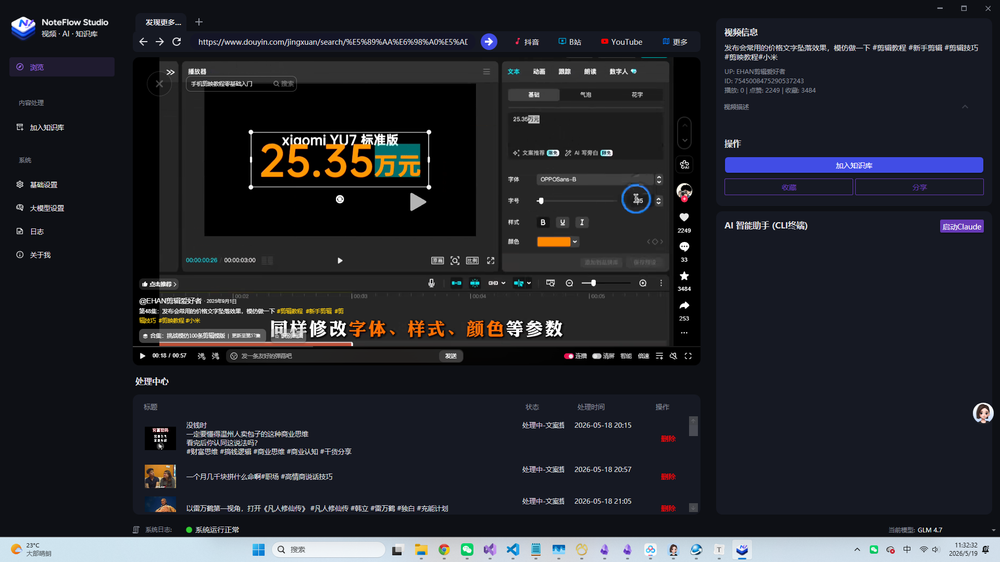
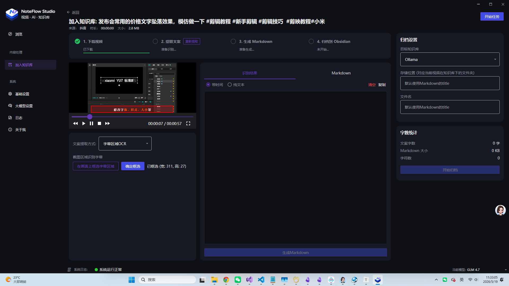
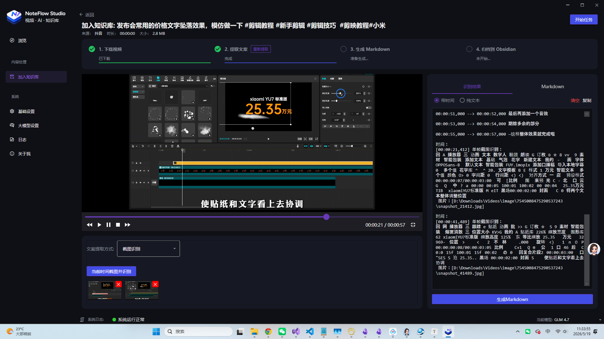
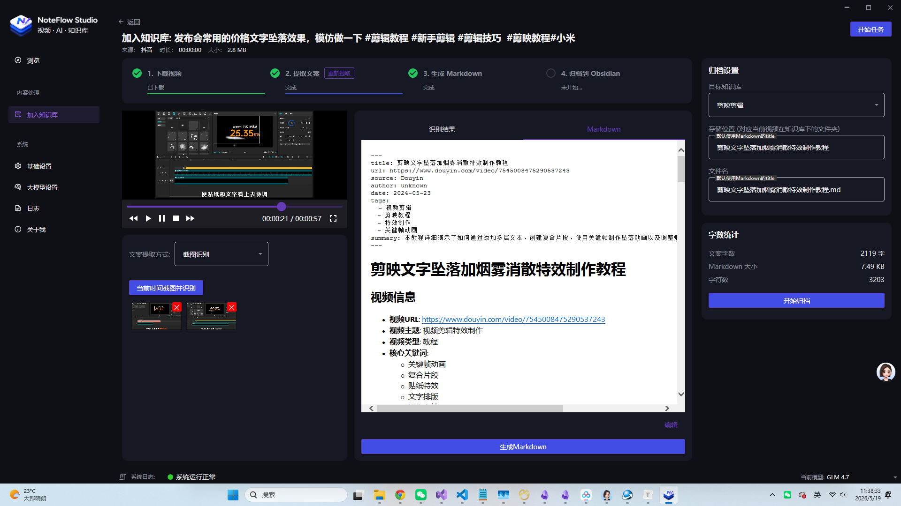
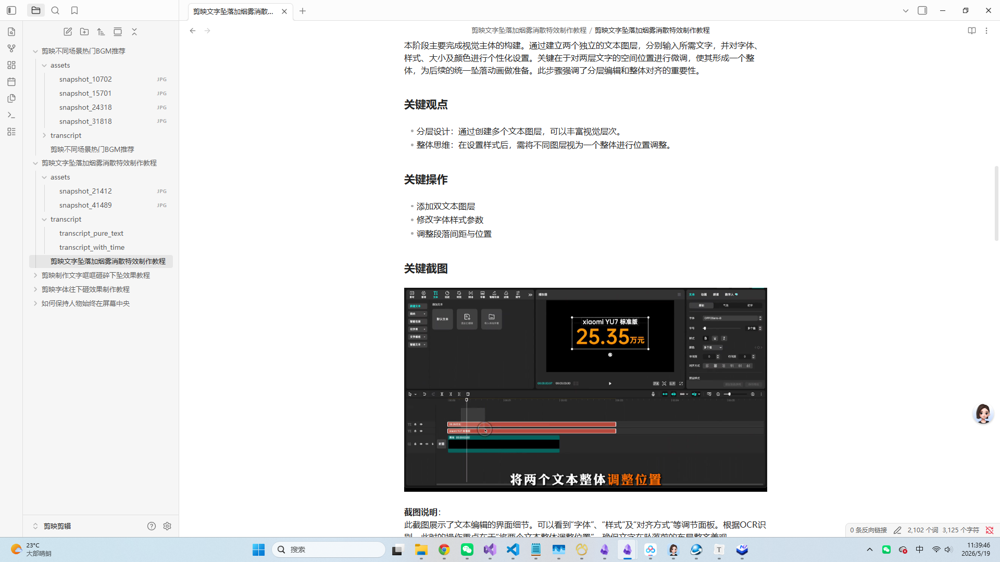
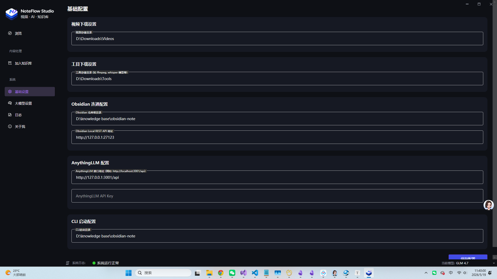
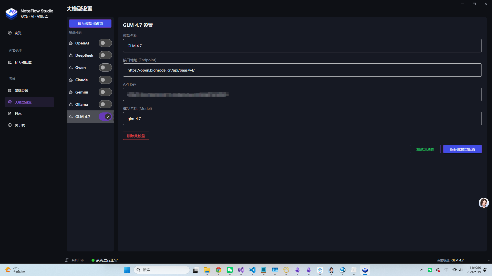
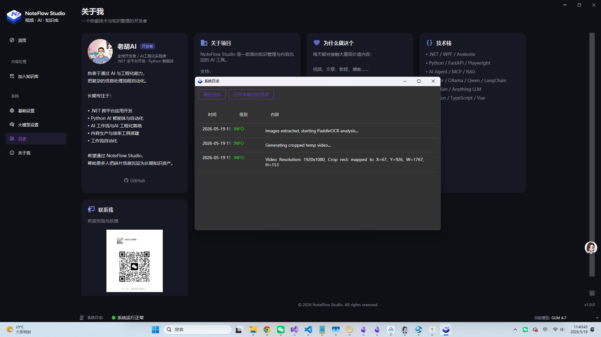

# NoteFlow Studio (自媒体知识库智能体)

**NoteFlow Studio** 是一个基于 C# WPF 开发的个人桌面端工具。

## 🌟 核心功能

核心目标是将你收藏的自媒体视频，自动提取文案/内容，利用 AI 将其转化生成规范的 Markdown 笔记，并支持**一键归档至 Obsidian** 知识库中。无需手动抄写和排版，实现自动化个人知识管理。

*   **视频与文案提取**：支持从各类自媒体流媒体提取视频和文字、文案内容。
*   **AI 深度处理**：利用 AI 总结、提炼、清洗提取的文案，直接输出规整的高质量 Markdown。
*   **Obsidian 联动**：一键归档到你的 Obsidian 本地仓库，无缝接入个人笔记系统中。

> **⚠️ 注意：关于 RAG 和向量数据库**
> 本项目目前**不使用** RAG（检索增强生成）和向量数据库（如 Qdrant），可以自行将笔记导入Anything LLM等RAG笔记。早期的相关功能已剥离或处于未启用状态，现在聚焦于“视频文本提取 + AI Markdown格式化 + Obsidian归档”的纯粹工作流。

---

## 🛠️ 技术栈与配置

- **前端/桌面端框架**: C# .NET 8, WPF (Windows Presentation Foundation)
- **内嵌浏览器**: CefSharp
- **视频与媒体下载**: yt-dlp
- **AI 大模型服务**: 你可以使用**任何支持 OpenAI 协议的第三方大语言模型 API**。
- **本地数据库**: **SQLite** 

---

## 🚀 开箱即用 (Release out-of-the-box)

对于不想配置开发环境的普通用户，可以完全**免安装 Visual Studio** 等繁琐依赖，直接开箱即用：

1. **下载 Release 包**：前往本仓库的 [Releases 页面](https://github.com/hujingjian/NoteFlow.Studio/releases) 下载最新编译好的免安装压缩包。
2. **解压后运行**：解压缩后双击运行主程序 .exe。
3. **基础配置**：
   - **AI 配置**：在设置页面填写你的 AI 接口地址 (Endpoint) 和密钥 (API Key)。如果你使用的是本地 Ollama，填入对应的本地地址即可；如果你使用第三方 API（如 DeepSeek、通义千问等的 OpenAI 兼容接口），填入对应信息。
   - **路径配置**：配置好你电脑上 Obsidian 仓库所在路径，以便实现一键归档落盘。
4. **开始使用**：通过内置浏览器或者剪贴板捕获，提取视频信息并自动化生成笔记。

---

## 👨‍💻 开发者指南

如果你希望二次开发，请确保你的环境具备：
- Visual Studio 2022 (带 .NET 桌面开发工作负载)
- .NET 8.0 SDK

1. 克隆代码库：git clone https://github.com/...
2. 用 Visual Studio 打开 .sln并还原 Nuget 包。
3. CefSharp 运行排障：如遇启动白屏/黑屏，请将编译过的CefSharp Dll（支持H264视频格式） 目录中的附加内容复制到Bin/x64/Debug 对应的原生运行时目录下。
4. 按 F5 编译运行即可。

---

## 📸 截图预览

---

## 📄 开源许可证

本项目基于 **MIT** 许可协议开源。
有关详细的许可条款与信息，请参阅代码库根目录下的 [LICENSE](LICENSE) 文件。
